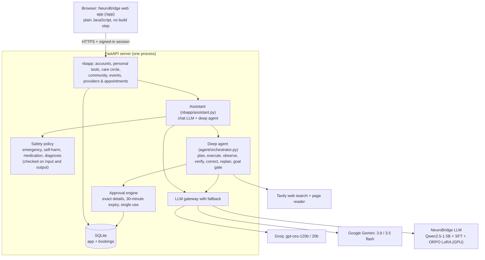

# NeuroBridge: an AI support platform for neurodivergent people and their caregivers


**Group Maple**

| Name | Roll number |
|---|---|
| Lisa Luis | 25P0620008 |
| Muskan Aga | 25P0620011 |
| Shannon Coelho | 25P0620019 |

NeuroBridge is a web application for neurodivergent people (autism, ADHD, dyslexia and
others) **and** the people who support them. It combines a supportive chat LLM, a research
agent that searches the web with sources and can book appointments with psychiatrists and
therapists after the user approves, daily-living tools, a caregiver space built on consent,
and a moderated community.

> **Not a doctor and not an emergency service.** NeuroBridge does not diagnose, change
> medication or make emergency decisions. Every consequential action (booking, registering,
> sharing) needs the user's explicit approval. In an emergency in India, call **112**.

## Submission contents

| Item | Where |
|---|---|
| Final report (PDF) | [`Project-Report.pdf`](Project-Report.pdf) |
| Report LaTeX source | [`Documentation/Report-LaTeX/`](Documentation/Report-LaTeX/) |
| Source code | `agent/`, `nbapp/`, `neurobridge_llm/`, `scripts/`, `tests/` (see [`Source-Code/`](Source-Code/)) |
| Documentation | [`Documentation/`](Documentation/) and [`docs/`](docs/) |
| Screenshots | [`Screenshots/`](Screenshots/) (29 screens, with an index) |
| Demo | [`Demo/`](Demo/): live link, walkthrough and Colab notebook |

## Live demo

**https://neurobridge-428948222095.asia-south1.run.app**
**With our own fine-tuned models (GPU):** https://neurobridge-models-428948222095.asia-southeast1.run.app
Choose *NeuroBridge SFT* in the Assistant's model menu. The first reply can take about a minute while the model loads.

| Role | Email | Password |
|---|---|---|
| Individual | `asha@demo.neurobridge.local` | `MapleDemo2026` |
| Caregiver (linked to Asha) | `ravi@demo.neurobridge.local` | `MapleDemo2026` |
| Moderator (admin) | `mod@demo.neurobridge.local` | `MapleDemo2026` |

- All people, clinics and events in the demo are fictional and labelled *demo*.
- The site runs on Google Cloud Run. The first visit after a quiet spell can take a few
  seconds to load, and data entered on the site resets when the server restarts.
- The live site uses the hosted models (Groq and Gemini). Our own fine-tuned model needs a
  GPU, so it runs from the Colab notebook (see *How to run* below).

## Architecture



**How a request flows.** Every message first passes the **safety policy**. An emergency,
such as *"my dad is choking"*, gets fixed first-aid steps and *call 112* straight away, with
no AI involved. Ordinary messages go to the **chat LLM**. Research or booking requests go to
the **deep agent**, which plans the steps, searches the web through Tavily, reads pages, checks
that every claim has a source, and retries when evidence is missing. When an action is
needed, such as booking a psychiatrist, the agent **stops and shows an approval card** with
the exact clinic, time and fee. Nothing is booked until the user approves. Bookings stay
*waiting for the clinic* until an admin records the clinic's confirmation.

**Main parts.**
- **Individual:** My Day, Assistant, Tasks (help-me-start, body-doubling), Routines,
  Check-in, Sensory toolkit, Communication cards (with text-to-speech), private Journal,
  Support Blueprint, Goals, Learn & life skills, and an *I'm overwhelmed* calm mode on every
  page.
- **Caregiver:** dashboard, care journal, care calendar, coordination, and wellbeing. A
  caregiver sees only what the person chose to share (consent scopes).
- **Community Connect:** interest groups, posts, replies, reactions, connections and private
  messages. Includes reporting, blocking, a moderation queue (for example, phone numbers are
  held for review) and protections for under-18 users.
- **Providers & appointments:** an admin-verified directory of psychiatrists, psychologists
  and therapists. Clinics found on the web can be tracked with a ready-to-send message.
- **Admin:** moderation, provider verification, clinic confirmation and event review.

More detail: [`docs/ARCHITECTURE.md`](docs/ARCHITECTURE.md) and
[`docs/WEB_APP_GUIDE.md`](docs/WEB_APP_GUIDE.md).

## Technologies

| Area | Technology |
|---|---|
| Backend | Python 3.12, FastAPI, Uvicorn, Pydantic |
| Database | SQLite (numbered migrations) |
| Frontend | HTML, CSS, plain JavaScript single-page app (no build step), responsive and dark mode |
| Hosted LLMs | Groq (`openai/gpt-oss-120b`, fallback `gpt-oss-20b`), Google Gemini (`gemini-3.8-flash` with fallbacks) |
| Our own LLM | Qwen2.5-1.5B-Instruct fine-tuned with LoRA: SFT, then ORPO preference tuning (Hugging Face Transformers, PEFT, Accelerate, Datasets, bitsandbytes 4-bit) on a Colab T4 GPU |
| Agent tools | Tavily search and extraction (DuckDuckGo as a keyless fallback), BeautifulSoup page reader, booking and events tools, optional MCP server |
| Safety | Rule-based policy on input and output, approval engine, consent-based memory, rate limits, hashed passwords |
| Testing | pytest (179 offline tests), live evaluation script |
| Deployment | Docker, Google Cloud Run (`asia-south1`), Render blueprint (`render.yaml`), Google Colab |

## How to run

### Option 1: use the live site
Open the link above and sign in with a demo account. Nothing needs to be installed.

### Option 2: Google Colab (includes our fine-tuned model)
1. Open [`RUN_NeuroBridge_Website.ipynb`](RUN_NeuroBridge_Website.ipynb) in Google Colab.
   It downloads this repository by itself.
2. Click the key icon (*Secrets*) and add `GROQ_API_KEY`, `GEMINI_API_KEY`,
   `TAVILY_API_KEY` and `NB_ADMIN_PASSWORD`, switching **Notebook access** on for each.
3. For our own model, choose **Runtime → Change runtime type → T4 GPU** and place the
   trained adapters in `MyDrive/neurobridge/llm_runs*/`.
4. Click **Runtime → Run all**. The last cell opens the website and prints the demo password.

### Option 3: run on your own computer
```bash
git clone https://github.com/lisaluis/Neurobridge-1.git
cd Neurobridge-1
python -m venv .venv
source .venv/bin/activate          # Windows: .venv\Scripts\activate
pip install -r requirements.txt

export GROQ_API_KEY=...            # Windows PowerShell: $env:GROQ_API_KEY="..."
export GEMINI_API_KEY=...
export TAVILY_API_KEY=...
python scripts/check_keys.py       # checks that each key really works

python scripts/seed_demo_app.py --password "choose-a-demo-password"   # optional demo data
uvicorn agent.api.app:app --port 8000
```
Then open **http://localhost:8000/app**. API documentation is at `/docs`.

### Option 4: deploy your own copy (Docker / Google Cloud Run)
```bash
gcloud run deploy neurobridge --source . --region asia-south1 --allow-unauthenticated \
  --max-instances 1 --memory 1Gi --env-vars-file env.yaml
```
`env.yaml` holds the API keys and the admin and demo passwords. Keep it out of Git. See
[`docs/DEPLOYMENT_GUIDE.md`](docs/DEPLOYMENT_GUIDE.md).

### Run the tests
```bash
python -m pytest -q tests/        # offline, no keys needed
```

## Ethics, safety and law (summary)
- **No diagnosis or medication advice.** Medication and diagnosis questions are redirected
  to professionals.
- **Emergencies** get fixed, tested first-aid guidance and **112**. Distress gets helplines
  (112, Tele-MANAS 14416).
- **Human in the loop.** The agent cannot book, register or share anything without the
  user's explicit approval of the exact details.
- **Consent and privacy.** The journal is always private. Caregivers see only what the person
  shares. Memory is consent-based, and passwords are hashed.
- **Academic prototype.** NeuroBridge has not been clinically validated or tested with real
  users, and no compliance with GDPR, India's Digital Personal Data Protection Act or HIPAA
  is claimed.
- **Honesty.** Answers cite sources, and demo data is always labelled. Web clinics are never
  shown as bookable.

The full discussion is in the report, [`Project-Report.pdf`](Project-Report.pdf).

---

# Developer reference

## Code layout

```
agent/
  orchestrator.py      plan → execute → observe → verify → correct → replan → goal gate
  loop.py              bounded task loop (approval pauses, honest dry-run flag)
  planner/planner.py   LLM planner (tool/skill-aware; validated by the orchestrator)
  executor/            engine (lifecycle + approvals), tool executor, tool bridge (retries)
  tools/               web_search, web_page_reader, booking_db, builtin registry
  research/            evidence, synthesis, verification, correction, goal_gate, expansion
  safety/policy.py     emergency / self-harm / medication / diagnosis checks (in & out)
  middleware/          language policy + script detection
  llm/                 gateway (fallback), Groq, Gemini, multilingual wrapper
  memory/              consent-based memory store / suggestion / approval
  skills/              skills registry (reconstructed — see AUDIT)
  mcp/server.py        optional MCP server (read-only tools)
  api/app.py           FastAPI app;  api/static/index.html  original agent console at /ui
nbapp/                 the web application (mounted on the same FastAPI app)
  db.py                SQLite schema + numbered migrations      security.py  passwords, sessions, rate limits
  consent.py           care-circle permissions (scopes)         notify.py    notifications + quiet hours
  routes_*.py          accounts, personal, care, community, events/providers/learning
  assistant.py         one assistant = chat LLM + deep agent, with safety, approvals, memory
  static/              the web app UI (/app): plain JS, no build step
neurobridge_llm/       LLM pipeline: data/raw (recovered datasets), nbllm/ (pipeline, train_sft,
                       evaluate, human_eval, orpo_gate), configs/, NeuroBridge_LLM_Pipeline.ipynb
tests/                 offline test suite (179 tests: web app, providers & booking, agent, safety, LLM pipeline, real tiny-model training smoke test)
scripts/live_eval.py   live evaluation with real keys
backups/               untouched reconstruction of the original notebook state
```


## Run locally

```bash
cd Neurobridge-1
python -m venv .venv && source .venv/bin/activate
pip install -r requirements.txt

export GROQ_API_KEY=...          # and/or GEMINI_API_KEY=...
export TAVILY_API_KEY=...        # recommended for search + page reading
# optional: export NEUROBRIDGE_ADMIN_TOKEN=some-long-secret   (provider verification/slots)
# optional: an admin account for moderation (never hard-coded):
# export NEUROBRIDGE_ADMIN_EMAIL=you@example.org NEUROBRIDGE_ADMIN_PASSWORD='a-long-password'

# optional: clearly-labelled demo accounts + sample data to explore the app
python scripts/seed_demo_app.py --password "choose-a-demo-password"

uvicorn agent.api.app:app --port 8000
# open http://localhost:8000/app   (agent console: /ui, API docs: /docs)
```

In production also set `NEUROBRIDGE_DISABLE_LEGACY_API=1` so only the signed-in `/api/*`
routes are reachable (the older `/chat`, `/agent`, `/booking`, `/events`, `/memory` endpoints
take a user id in the request and have no sign-in).

Run the tests (offline, no keys needed):

```bash
python -m pytest -q tests/
```

Run the live evaluation (uses your keys and the real web):

```bash
python scripts/live_eval.py
```

## Colab notebook details

Use **`RUN_NeuroBridge_Website.ipynb`** (top of the repository). It:

1. downloads this repository from GitHub (or uses a `NeuroBridge_Deep_Agent_v*.zip` / `Neurobridge-1*.zip` in My Drive if there is one) and installs it;
2. loads `GROQ_API_KEY`, `GEMINI_API_KEY`, `TAVILY_API_KEY`, `NB_ADMIN_PASSWORD` from Colab
   Secrets and runs `scripts/check_keys.py`, which makes one tiny real request to each service
   and says plainly what is wrong (rejected key, used-up quota, model not enabled, no network);
3. keeps app data on Drive (`MyDrive/neurobridge_data`) so accounts survive restarts;
4. turns on your trained base / SFT / SFT+ORPO models automatically if their adapters are in
   `MyDrive/neurobridge/llm_runs*/` and a GPU is on (otherwise Groq + Gemini only);
5. optionally loads clearly-labelled demo accounts, events and four demo clinics;
6. starts the server and opens `/app`.

Models: Groq `openai/gpt-oss-120b` (falls back to `openai/gpt-oss-20b`), Gemini
`gemini-3.8-flash` (falls back to `gemini-3.5-flash`, `gemini-3.5-flash-lite`,
`gemini-2.5-flash` — Google serves 2.5 only to keys that used it before). Both run with low
hidden "thinking" so answers aren't cut off. Override with `NEUROBRIDGE_GROQ_MODEL` /
`NEUROBRIDGE_GEMINI_MODEL`.

## NeuroBridge LLM (dataset → SFT → evaluation)

```bash
cd neurobridge_llm
python -m nbllm.pipeline build                    # offline, ~4 s
# GPU (Colab T4): open neurobridge_llm/NeuroBridge_LLM_Pipeline.ipynb and run top to bottom
```

To serve the three models (base / SFT / SFT+ORPO) with a model picker and side-by-side compare in the UI:
`NEUROBRIDGE_LOCAL_MODEL=Qwen/Qwen2.5-1.5B-Instruct NEUROBRIDGE_SFT_ADAPTER=.../runs/sft_v2_12k/adapter
NEUROBRIDGE_ORPO_ADAPTER=.../runs/sft_orpo_v1/adapter`. The notebook's last cell does this.

## Events, groups and clubs

`NEUROBRIDGE_SEED_DEMO_EVENTS=1` adds 11 clearly-labelled demo listings: support circles,
an ADHD body-doubling club, a sensory-friendly art club, a hearing-voices peer group, a DID
peer group, workshops, gatherings and community meetings. Book them in **Events & groups**,
or ask the agent ("find an online ADHD club and sign me up"); you approve the exact details
first. Real listings: `POST /events` with `x-admin-token`.

## Using the API

The web app uses the signed-in `/api/*` routes (Bearer token from `POST /api/auth/login`);
the full list is at `/docs`. The original agent endpoints are below.

| Endpoint | Purpose |
|---|---|
| `POST /chat` | Support chat (safety-checked in and out, multilingual, memory-aware with `user_id`) |
| `POST /agent/run` | Research agent run: `{goal, success_criteria, user_id, preferred_language, allow_booking_actions}` |
| `GET /agent/runs/{id}` | Run status, answer, sources, verification, tasks, trace |
| `POST /agent/runs/{id}/approve` | Approve or decline a paused action: `{approval_id, approved}` |
| `GET /agent/tools` | Registered tools, permissions, approval flags |
| `POST /chat/compare` | Same message to several models: `{message, providers:["nb_base","nb_sft","nb_sft_orpo"]}` (no silent fallback) |
| `GET /events`, `GET /events/{id}/prepare`, `POST /events/{id}/register` | Events; register needs `explicit_approval` + the `approved_details_hash` from prepare (409 if details changed) |
| `GET /events/mine/{user}`, `POST /events/registrations/{id}/cancel`, `POST /events` (admin) | Registrations / organisers |
| `GET /booking/slots`, `/booking/providers` | Verified registry only |
| `POST /booking/request` → `POST /booking/approve` | Caregiver request, then explicit approval (`explicit_approval: true`) |
| `POST /booking/providers/register` | New provider (pending until verified) |
| `POST /booking/providers/{id}/verify`, `POST /booking/slots` | Admin only (`x-admin-token`) |
| `/memory/*` | Consent-gated memory (as in the notebook) |

Run statuses: `COMPLETED` (goal gate passed), `PARTIAL`, `WAITING_APPROVAL`,
`NO_EVIDENCE`, `FAILED`, `EMERGENCY_GUIDANCE`.

### MCP (optional)

```bash
python -m agent.mcp.server        # stdio; exposes web_search, web_page_reader, provider_search, find_slots
```

Booking actions are intentionally not exposed over MCP.
